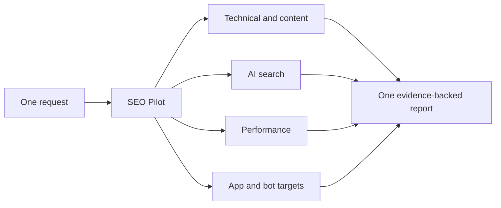

# SEO Pilot

### One skill for SEO, AI search, app discovery and web performance.

[](https://github.com/black12-ag/seo-pilot/actions/workflows/verify.yml)
[](LICENSE)
[](https://agentskills.io/)

Give your AI coding agent one command. Get a coordinated audit with evidence, prioritized fixes and verification steps—without loading dozens of overlapping instructions.

**92 bundled modules, three open-source collections, one entry point.** SEO Pilot brings together [Claude SEO](https://github.com/AgriciDaniel/claude-seo), [Marketing Skills](https://github.com/coreyhaines31/marketingskills), and [Web Quality Skills](https://github.com/addyosmani/web-quality-skills). Their source, supporting resources and MIT notices are bundled at pinned revisions. The integration, shared workflow and routing are new; the upstream modules retain their authorship.

## Start in one command

```sh
npx skills add black12-ag/seo-pilot --skill seo-pilot
```

Choose your agent in the installer, then ask it:

```text
Use $seo-pilot to audit https://example.com
```

For Codex only, install globally with:

```sh
npx skills add black12-ag/seo-pilot --skill seo-pilot --agent codex --global --yes
```

This uses the open Agent Skills format. The Skills installer supports agents such as Codex, Claude Code, Cursor and Gemini CLI. Invocation syntax depends on the host: Codex uses `$seo-pilot`; Claude Code can expose `/seo-pilot`. Other hosts can follow the installed `SKILL.md` when asked to use SEO Pilot. Reload your agent if newly installed skills are not yet listed.

## Copy a prompt and go

| Goal | Prompt for your AI coding agent |
|---|---|
| Full website audit | `Use $seo-pilot to audit https://example.com` |
| Audit and fix a codebase | `Use $seo-pilot to audit this project, fix the verified SEO issues, and run the relevant checks.` |
| AI search / GEO / AEO | `Use $seo-pilot ai https://example.com — check ChatGPT, Google AI search and Perplexity visibility.` |
| AI competitors and citations | `Use $seo-pilot ai https://example.com — compare our brand with <competitors>, save repeated prompt evidence, and report mentions, citations and recommendations separately.` |
| Existing AI tracking exports | `Use $seo-pilot to analyze these AI-search observations, check answer accuracy and cited-source gaps, and prioritize verified fixes.` |
| Speed and responsiveness | `Use $seo-pilot performance https://example.com — measure before recommending changes.` |
| App Store / Google Play | `Use $seo-pilot app <listing-url> — improve discovery and listing conversion.` |
| Public bot discovery | `Use $seo-pilot bot <public-profile-url> — audit profile, localization and product links.` |
| Product SEO | `Use $seo-pilot ecommerce https://example.com — check product facts, schema and category discovery.` |
| All your surfaces | `Use $seo-pilot to audit <website>, <app-listing> and <bot-profile> in one report.` |
| A specific bundled feature | `Use $seo-pilot module marketingskills:content-strategy for this project.` |

Use ordinary language too: “Use SEO Pilot to fix my sitemap” is enough. A narrow request stays narrow; a website audit does not automatically launch ads or rewrite your pricing.

## What is inside?

| Area | Included capabilities |
|---|---|
| Technical SEO | Crawling, indexing, robots, canonicals, redirects, sitemaps, rendering, internal links and international SEO |
| AI SEO / GEO / AEO | Purpose-specific crawler access (including Claude), product facts, prompt portfolios, answer accuracy, sentiment review, competitor/source gaps, citation/recommendation measurement and AI referrals |
| Content | Search intent, content strategy, topic clusters, comparisons, copywriting and content quality |
| Ecommerce and local | Product/category SEO, structured data, local business and map/listing workflows |
| Performance | Field and lab evidence, LCP, INP, CLS, accessibility and technical web quality |
| App and bot discovery | App Store/Google Play metadata and visuals; public bot profiles, localized messaging and deep links |
| Optional integrations | Google search/analytics data, backlink and keyword tools, and upstream specialist workflows when their dependencies/access exist |

All **26 Claude SEO**, **53 Marketing Skills**, **6 Web Quality Skills**, and **7 unique optional extension modules** are retained. Non-SEO marketing modules are available on explicit request; they are not all executed during an SEO audit. List the exact pinned module IDs with the offline helper below.



## What makes this a combined skill?

- **One owner per topic.** Overlapping checklists produce one finding, not three repeated reports.
- **Evidence stays separate.** Local code is not treated as production; old analytics is not current field data; raw HTML is not a rendered browser check.
- **AI SEO has its own workflow.** Search access is distinct from model-training permission. `llms.txt` is an optional experiment, not a promised Google ranking lever.
- **Repeatable AI measurement.** An offline helper validates supplied observations, separates mentions/citations/recommendations, reports sample sizes and errors, and keeps engines, surfaces and markets separate. It makes no model calls and does not invent missing results.
- **Practical connector selection.** A [dated comparison of 12 tools](skills/seo-pilot/references/connectors.md) covers OpenSEO, Ahrefs, Semrush, Ubersuggest, OpenRush, Conductor and supporting tools. Product features, actual connector access and proprietary data requirements stay distinct.
- **Portable references.** The installed skill includes the upstream resources. No separate global install of the three collections is required to read them.
- **Pinned, attributed sources.** Upstream revisions are recorded and imported file hashes are checkable. Existing skills are not overwritten.
- **One useful output.** A prioritized report names each issue's evidence, owner, fix and verification. If changes were requested, the agent implements within that scope and checks its work.

## Requirements and honest limits

This is an **agent skill**, not a standalone SEO engine. It needs an AI coding assistant capable of reading skills and using appropriate tools. It cannot guarantee rankings, indexing, AI recommendations or traffic growth.

The offline list, route, integrity and doctor helpers require Python 3.11+ and no third-party Python packages. Live audits need network access. Rendered-page/performance checks need browser tooling; Google/keyword/backlink integrations may need credentials, quota or paid providers. Those integrations are optional, and their fees are not included. Claude SEO's optional runtime supports Python 3.11–3.14 at the pinned version.

The AI measurement helper uses manually reviewed or vendor-supplied answer observations. It summarizes the supplied sample, not global market share or independently verified evidence. It does not collect live answers, schedule monitoring or include paid data. Native Google/Bing reports, vendor datasets, prompt samples and analytics referrals are treated as separate measurements; current official platform guidance takes precedence over dated bundled references.

Without a tool or account, the agent reports that check as **not assessed**, continues independent checks, and avoids invented metrics. Installed resources are not proof that every external service is configured. Upstream installations, hooks, paid calls and publication tools are never run just because the files are bundled.

## Offline tools

From a clone of this repository:

```sh
python3 skills/seo-pilot/scripts/seo_pilot.py list
python3 skills/seo-pilot/scripts/seo_pilot.py route all --url https://example.com
python3 skills/seo-pilot/scripts/seo_pilot.py route ai --url https://example.com
python3 skills/seo-pilot/scripts/seo_pilot.py check
python3 skills/seo-pilot/scripts/seo_pilot.py doctor
```

For an existing answer-observation file:

```sh
python3 skills/seo-pilot/scripts/ai_visibility.py observations.jsonl \
  --brand Example --domain example.com --competitor Rival
```

See [AI visibility measurement](skills/seo-pilot/references/ai-visibility.md) for the JSONL format, illustrative records, denominators and the source/accuracy-to-fix workflow. The helper does not fetch websites or call an AI service. Use `$seo-pilot ai <url>` in your agent to coordinate the actual audit with the tools you have.

**`route` prints a workflow plan. It does not fetch your site or claim an audit was performed.** The agent's one-command invocation executes the selected checks using the tools available to that agent.

For the optional Claude SEO runtime, use the launcher inside `skills/seo-pilot/vendor/claude-seo/scripts/claude-seo`; its `doctor --json` checks readiness without installing dependencies. See that source's bundled runtime documentation before setup. On Windows, use Python with its `scripts/runtime.py`.

## Contribute or update sources

```sh
git clone https://github.com/black12-ag/seo-pilot.git
cd seo-pilot
python3 -m unittest discover -s tests -v
python3 skills/seo-pilot/scripts/seo_pilot.py check
```

Source revisions live in [`sources.lock.json`](sources.lock.json). To refresh imports, review the new commits and licenses, update the lock, prepare clean checkouts of the three repositories under a common directory, then run:

```sh
python3 scripts/build_bundle.py --source-dir /path/to/reviewed-checkouts
```

The builder rejects mismatched or dirty revisions and symlinks that escape a checkout. It imports tracked source only, omits generated cache/bytecode files, and materializes internal aliases from tracked members. Never edit imported files in place; improve the integration or contribute upstream, then repin. Re-run tests and a real agent scenario after changing routing or instructions.

Packaging/routing tests cover module inventory, relocation, source drift, integrity, path containment and selected workflows. They do not certify every optional upstream integration or future search-engine behavior.

## License and credits

SEO Pilot's integration is [MIT licensed](LICENSE). Bundled sources keep their own MIT licenses and copyright notices. See [NOTICE.md](NOTICE.md) for exact sources and revisions.

Built on work by AgriciDaniel and the Claude SEO contributors, Corey Haines and the Marketing Skills contributors, and Addy Osmani and the Web Quality Skills contributors. SEO Pilot is an independent integration, not an endorsement by those authors, Google, OpenAI, Apple or Telegram.
